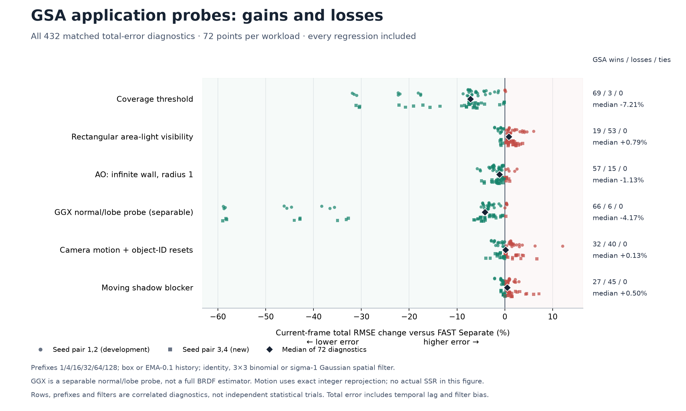
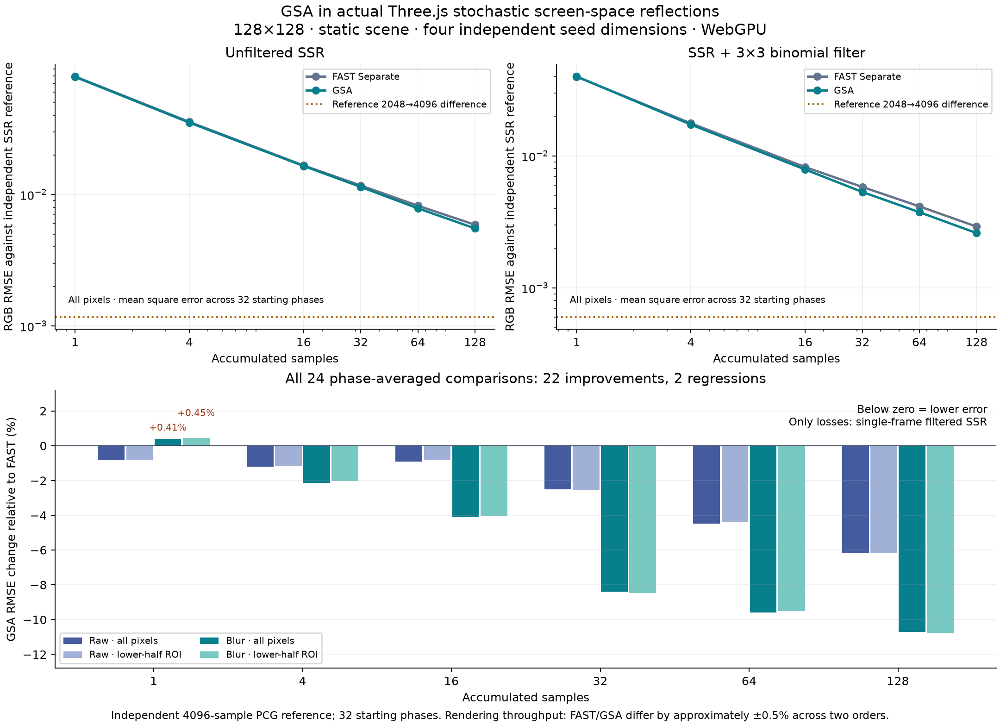

# three-gsa

**GSA — GPU Stratified Annealing** is a new blue-noise sampling method and
TypeScript library for Three.js. It combines per-pixel temporal stratification
with filter-aware GPU optimization, keeping noise easier to remove with spatial
and temporal reconstruction.

Compared with the 10,000-step FAST Separate reference, GSA generates its mask
**1.99× faster** and produces lower error in **262 of 318 measured diagnostics**
on each of two seeds. It improves every original spatial/temporal diagnostic.
The full comparison below includes the 53 regressions and three ties per seed.

| Measurement | GSA result versus FAST Separate |
| --- | --- |
| Construction, seed 1 | 30.720 s vs 61.233 s — **1.993× faster** |
| Construction, seed 2 | 30.756 s vs 61.339 s — **1.994× faster** |
| Blurred 32-frame scalar integration RMSE | **22.8% lower** |
| Blurred 32-frame threshold-at-.5 RMSE | **25.5% lower** |
| Blurred 32-frame squared-integrand RMSE | **20.0% lower** |
| Blurred 32-frame fourth-power RMSE | **14.7% lower** |
| Median relative change across 318 diagnostics, seed 1 | **5.6% lower** |
| Largest regression | **7.03% higher**: single-frame blurred high-frequency sine |

The integration-RMSE rows use the same 128×128×32 masks, 8-bit midpoint decoding, all 32
starting phases and identical filters. Construction compares GSA's 3,000-step
profile with FAST's 10,000-step profile on a physical AMD GCN-5 GPU; each timed
run completes its GPU readback before the next begins.


## Graphics workloads

GSA lowers total image RMSE in **270 of 432** geometric application/filter/frame
comparisons. The chart includes every gain and loss. Each workload has 72
comparisons: two independent seed pairs, six frame counts, two temporal filters
and three spatial filters. Total RMSE includes reconstruction bias and temporal
lag against the current analytic image. These are correlated diagnostics, not
independent statistical trials.



| Workload | Lower / higher error | Median RMSE change |
| --- | ---: | ---: |
| Stochastic coverage | 69 / 3 | **−7.21%** |
| GGX normal/lobe environment probe | 66 / 6 | **−4.17%** |
| Finite-distance AO at an infinite wall | 57 / 15 | **−1.13%** |
| Camera motion, parallax and history resets | 32 / 40 | +0.13% |
| Moving rectangular blocker | 27 / 45 | +0.50% |
| Static rectangular area-light shadow | 19 / 53 | +0.79% |

The GGX probe tests a separable normal/lobe integrand. The camera test uses exact
integer reprojection and object-aware history resets.

### Actual Three.js reflections



The actual Three.js SSR test exercises coupled sampling dimensions, GGX reflection
and ray-march hit/miss. GSA improves **22 of 24** phase-averaged measurements.
Across all 32 starting phases, blurred reflection RMSE falls **8.38% at 32
frames**, **9.60% at 64** and **10.70% at 128**. At 64 and 128 frames every
starting phase improves, with and without blur. Single-frame blurred error is
**0.41–0.45% higher**. Four independently generated masks supply sampling
dimensions; the reference uses 4,096 independent PCG samples of the same SSR
estimator. The scene has three roughness levels and a fixed camera.

Rendering throughput is effectively equal: FAST **2,212 / 2,219** versus GSA
**2,222 / 2,207** GPU-completed frames/s in reversed-order, three-second windows
on the physical AMD GPU using D3D12. The measured advantage is reconstruction
quality and construction cost, with equal texture lookup cost.

**Choose GSA** for the tested accumulated coverage, AO and filtered SSR workloads.
**Choose FAST Separate** for the tested rectangular soft-shadow cases or when
single-frame high-frequency transformed noise dominates: `sin(14*pi*u)` and
`cos(16*pi*u)` have up to 7.03% higher blurred error with GSA. Moving geometry and
camera histories have mixed results, with FAST slightly ahead in the median
shadow measurements. GSA performs better across most measured diagnostics; these
results identify specific application choices rather than establishing a winner
for most graphics applications.

See [the reproducible evidence](docs/research/README.md) for exact inputs,
filters, analytic references, lifecycle checks, timing records and full results.


## Run the example

Requires Node.js 22+ and pnpm 11. The packages are source code in this repository;
no npm publication or hosted deployment is assumed.

```powershell
pnpm install
pnpm dev
```

Open the local URL printed by Vite. The example loads the evaluated 516 KiB
grayscale PNG by default and compares white noise with GSA using the same visibility
function, spatial filter and temporal accumulation. Use Reset to start from frame
one. A scalar-field view and filter toggles are available. Its interactive spatial
filter is a 3×3 binomial blur, **different from** the benchmark's sigma-1 Gaussian;
use the research scripts for the published measurements.

The optional **Generate a new GSA mask** button uses hardware WebGPU in a secure
context (localhost qualifies). Generation takes seconds to tens of seconds and
reports progress; it is not performed during startup or every frame. The example
renders with WebGL2 and continues showing the existing mask while generation runs.

## Library

The workspace has a library in `packages/three-gsa` and a Vite example in
`packages/example`. The generator is a separate import so applications using a
precomputed PNG do not need its optimizer code.

```ts
import { generateGSA } from 'three-gsa/generator';
import { createGSADataTexture } from 'three-gsa/three';

const controller = new AbortController();
const volume = await generateGSA({
  // Evaluated defaults: 128×128×32, seed 1, 3000 iterations.
  signal: controller.signal,
  onProgress: ({ completed, total }) => console.log(completed / total),
});
const atlas = createGSADataTexture(volume);
// Dispose atlas when no longer used.
```

`generateGSA` returns `{ size, depth, values: Float32Array }` in z/y/x order.
It optionally accepts an existing `GPUDevice`, which remains owned by the caller.
Otherwise it requests a hardware adapter and destroys its device after completion.
Buffers are released on success, failure or cancellation. Cancellation is checked
between synchronized 100-iteration batches. Defaults preserve the evaluated method;
the published quality profile is 128×128×32 at 3,000 iterations. A numerical
check verifies positive eigenvalues for the implemented combined filter kernel
on 21 periodic grids, spanning sizes 8/32/128 and depths 2–128.

For TSL with a precomputed PNG:

```ts
import { TextureLoader, NoColorSpace, NearestFilter } from 'three';
import { uniform, screenCoordinate } from 'three/tsl';
import { gsaSampleNode } from 'three-gsa/three';

const atlas = await new TextureLoader().loadAsync('/noise/gsa.png');
atlas.flipY = false;
atlas.colorSpace = NoColorSpace;
atlas.minFilter = atlas.magFilter = NearestFilter;
atlas.generateMipmaps = false;
atlas.needsUpdate = true;
const frame = uniform(0); // increment once per rendered sample, reset to zero
const scalar = gsaSampleNode(atlas, screenCoordinate, frame);
```

`gsaSamplingGLSL` provides equivalent GLSL 3 playback for WebGL2; the example uses it.
The dependency-free root entry provides `quantizeGSA`, `atlasIndex`, and `sampleGSA`
for CPU use. Encoded samples are decoded at byte-stratum midpoints:
`(byte + 0.5) / 256`. After each 32-frame stack the default playback shifts the
pixel coordinates by `(37, 71)`, matching the benchmark. Changing playback changes
the measured properties.

The default mask is a **single scalar** per pixel per frame. Use independently
generated masks for independent dimensions, as in the four-mask SSR test. Reusing
one scalar for every dimension creates correlated inputs. The benchmarked playback
shifts spatial coordinates at every 32-frame wrap; this convention is part of
reproducing the reported quality.

## Checks

```powershell
pnpm build
pnpm typecheck
pnpm lint
pnpm test
```

Unit tests cover byte decoding, cycle addressing, malformed inputs, cancellation
before GPU access and the committed PNG's hash and temporal stratification.
Browser GPU validation requires a physical GPU; software adapters are not accepted
as rendering-quality evidence.

```powershell
node scripts/verify-gpu.mjs ../three.js ../gpu-check-results
```

This optional check reuses an existing Three.js checkout's Puppeteer installation
and installed Chrome (`CHROME_PATH` can override the executable). It starts and
stops its own local Vite server and browser. It validates actual WebGL2 PNG and
DataTexture playback, TSL/WebGPU readback, mid-generation cancellation, controls,
and the complete default generation against the evaluated mask's SHA-256 hashes.
The recorded reference hash was reproduced on AMD GCN 5/D3D11. Actual SSR
validation also covers hardware D3D12. These records identify the tested adapter
and backends; cross-device byte identity is not required for sampling quality.

## Origins and license

This variant was found through AI-assisted exploration and evaluation during the
Three.js noise experiments in [PR 116](https://github.com/bhouston/three.js/pull/116),
building on [PR 115](https://github.com/bhouston/three.js/pull/115) and EA FAST.
Stratification, annealing and filter-based noise objectives are established ideas;
the contribution here is this combination of constraints, objective and schedule.

New code is MIT licensed. FAST-derived portions retain EA's BSD-3-Clause license.
See [third-party notices](packages/three-gsa/THIRD_PARTY_NOTICES.md) and the included
license files. The precomputed PNG's source profile and hashes are recorded beside
it in `packages/example/public/noise/source-manifest.json`.
