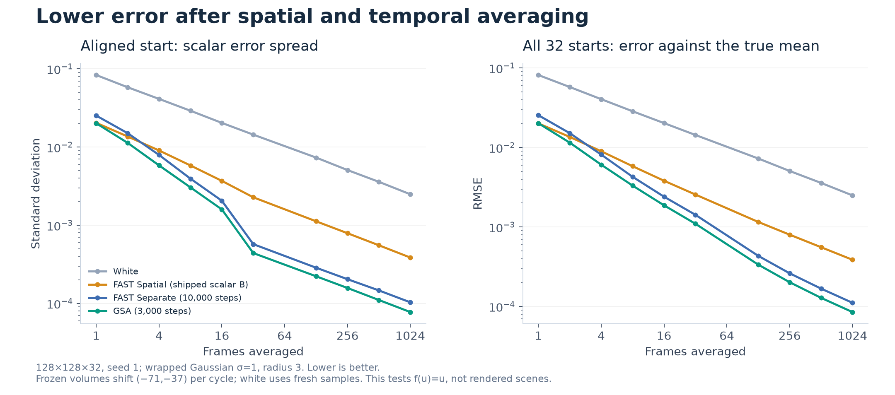
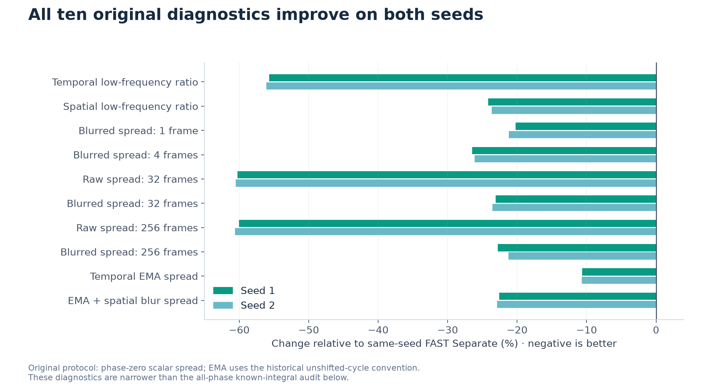
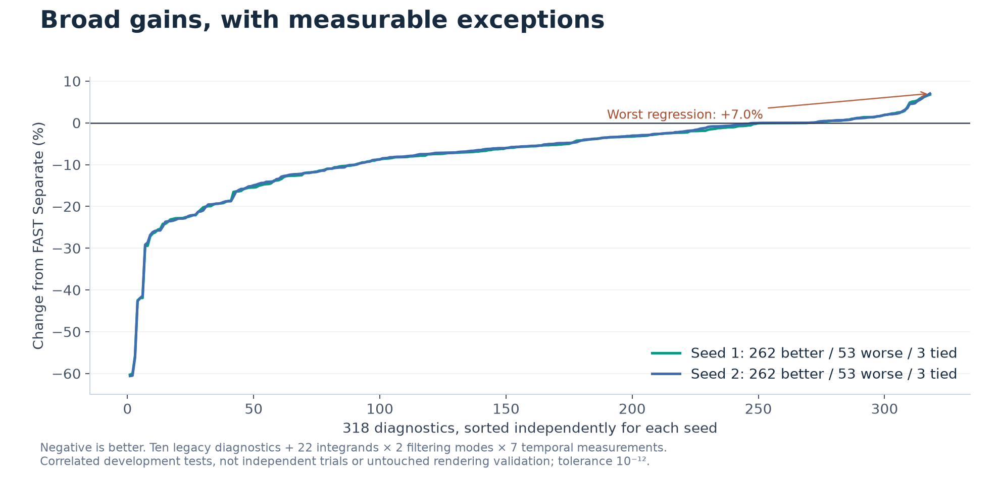
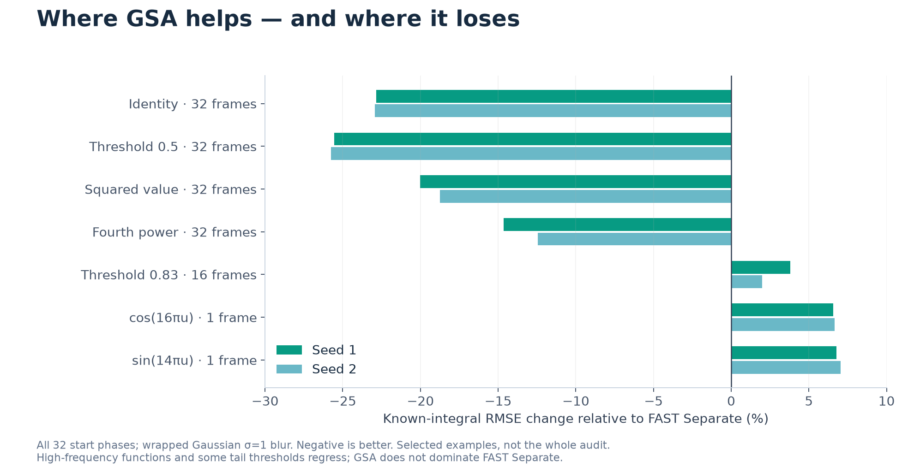
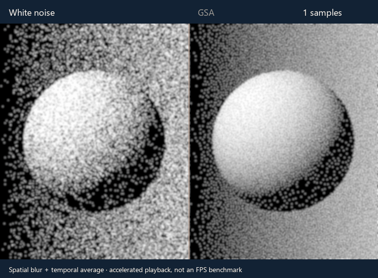

# Evidence and reproduction

GSA (GPU Stratified Annealing) is the particular experimental profile implemented
by this repository. It is derived from EA FAST and the Three.js research port;
stratification and simulated annealing are established methods, not inventions of
this project. See the package's third-party notices and FAST BSD-3-Clause license.

The search started while exploring noise for Three.js screen-space reflections.
The approximately 3 MB packed noise atlas motivated a search for cheaper
construction and a smaller scalar payload. AI agents proposed, implemented and
evaluated alternatives. A raw-scalar cancellation false lead prompted broader
transformed-function and phase-aware tests. This configuration is a promising
result of that process, not a proof of universal superiority or an SSR benchmark.

## Evaluated profile

- 128×128 pixels, 32 temporal slices, seeds 1 and 2.
- One independently jittered value in each temporal stratum at every pixel.
- Swaps restricted to temporal positions within the same pixel, preserving its
  complete sample multiset. This differs from FAST's per-slice stratification.
- Distance `-abs(a-b) - .25*(a-b)^2`.
- 80% separate spatial/temporal kernel plus 20% radius-two truncated product term.
- Acceptance suppression floor 2; temperature .001 decreases to zero over the
  first 1,500 iterations, followed by 1,500 greedy iterations.

The truncated mixed kernel is a heuristic, not guaranteed positive semidefinite.
Simultaneous accepted swaps do not guarantee global descent. The short run and
the constraints work well on the measured tasks; a different renderer, function,
filter or playback pattern can change the outcome.

## Fresh sequential construction timing

Physical AMD Radeon GCN-5, Chrome/WebGPU D3D11, fallback=false. Warmups (FAST 1,000
steps and GSA 300) were excluded. Full workloads ran sequentially, with vsync and
frame caps disabled and no other intentional GPU work. Each measurement counts
one GPU-completed volume, including navigation, adapter/device setup, pipeline
construction, compute, mapped GPU readback and transfer to the driver script.

| Seed | FAST Separate, 10,000 steps | GSA, 3,000 steps | Speed ratio |
| --- | --- | --- | --- |
| 1 | 61.233 s | 30.720 s | 1.993× |
| 2 | 61.339 s | 30.756 s | 1.994× |

These are two completed-volume trials of different configurations and quality
points, not matched-quality budgets, statistical significance or rendering FPS.
Both references and GSA outputs reproduce their historical Float32 hashes. Exact
settings, logs and hashes are in [generation-benchmark.json](generation-benchmark.json).
The extraction into the standalone library is additionally checked against the
same full-size output hash by the hardware validator.

GSA still takes tens of seconds. The example loads a precomputed 528,557-byte
grayscale PNG rather than optimizing during startup. The older 3,025,821-byte
FAST atlas stores additional distributions/components; this is a scalar payload
choice, not equivalent-content compression. Both generators ultimately produce
textures, so construction speed does not imply faster sample lookup.

## Filtering and convergence



Measurements include 1, 2, 4, 8, 16, 32, 128, 256, 512 and 1,024 frames. The left
panel is spatial standard deviation from a phase-zero running average; the right
includes bias by measuring RMSE against the known mean .5 over all 32 starting
phases. Both use wrapped sigma-1 Gaussian filtering with radius 3. Frozen masks
use the `(37,71)` cycle shift; white noise gets fresh values each frame. This is
the identity integrand, not a scene or multidimensional sampling comparison.

At 32 frames the all-phase blurred identity RMSE is 22.83% lower than FAST; at
1,024 it is 23.52% lower. The larger 60% aligned **raw** scalar spread improvement
in the original study does not generalize to arbitrary starting windows: cycle
shifts can cross spatial columns and weaken the temporal stratification benefit.

## Broader improvements and regressions





All ten original diagnostics improve on both tested seeds. The broader suite
uses 22 known-integral functions, raw and spatially blurred errors, six finite
windows and one EMA result, and every starting phase. Inputs are quantized to
8-bit bin centers before scoring. Each seed has **262 improvements, 53
regressions and three ties**, with absolute tie tolerance 1e-12. Seed 1's median
relative change is 5.6% lower. Counts are not independent statistical trials.



At 32 frames with blur, representative seed-1 RMSE reductions are identity 23%,
threshold .5 26%, square 20% and fourth power 15%. Worst losses are blurred
single-frame `sin(14*pi*u)` (+6.77%/+7.03% for seeds 1/2) and `cos(16*pi*u)`
(+6.55%/+6.66%). Threshold .83 after 16 blurred frames regresses about 3.8% on seed
1. Full provenance and chart values are in [gsa-chart-data.json](gsa-chart-data.json).

The published audit is a development suite. We have not established motion,
reprojection, disocclusion, multidimensional path sampling, independent SSR scene
quality or general state-of-the-art superiority. The interactive example uses a
3×3 binomial blur, not the analysis filter; its visual result is illustrative.

## Hardware animation



Fourteen selected captures from 1 through 128 accumulated samples of the original
Three.js sphere example. Both halves receive the same filtering. Frames come
from physical GPU canvas readback; the captioned GIF is accelerated and is not an
FPS or construction benchmark. [capture.json](capture.json) records the adapter,
viewport, filters and sample counts.

## Reproduce

The library/example need only their pnpm workspace. Research figures and the
original Three.js capture additionally use the pinned research checkout and
Python. All source reads use git-dedup. With `bhouston/three.js` checked out at
`bf8053703d208df3354256733d63c0506ef71c0f`, and PR117 commit
`2a065526980261bcf5b129f07ddb12ff7eda1f91` available locally:

```powershell
python -m pip install -r docs/research/requirements.txt
python docs/research/build-charts.py /path/to/three.js docs/research
node scripts/capture-three-example.mjs /path/to/three.js /path/to/capture
python scripts/build-gif.py /path/to/capture docs/research/convergence.gif
node /path/to/three.js/utils/fastnoise/experiments/run-gpu.js /path/to/benchmark docs/research/benchmark-plan.json
```

The capture and GPU runners default to installed Windows Chrome with D3D11 and
disable software rasterization. Other platforms need a verified hardware backend;
do not use SwiftShader, llvmpipe or lavapipe as validation substitutes. Capturing
the original example requires its installed Puppeteer dependency and build files.
SVG and PNG charts use Matplotlib's 2D raster/vector backend, not GPU rendering.
The chart script validates key values against the pinned audit to 1e-12.

The fresh timing runner's output can be compared with the committed record; it
does not automatically overwrite or statistically validate these two trials.

## Sources

- [Original exploration and common-protocol audit](https://github.com/bhouston/three.js/pull/116).
- [EA FAST source](https://github.com/electronicarts/fastnoise) and
  [FAST paper](https://arxiv.org/abs/2310.15364).
- [Scalar Spatiotemporal Blue Noise Masks](https://arxiv.org/abs/2112.09629).
- [Belcour–Heitz screen-space sampling study](https://belcour.github.io/blog/supp/2021-sampling-bluenoise/).
